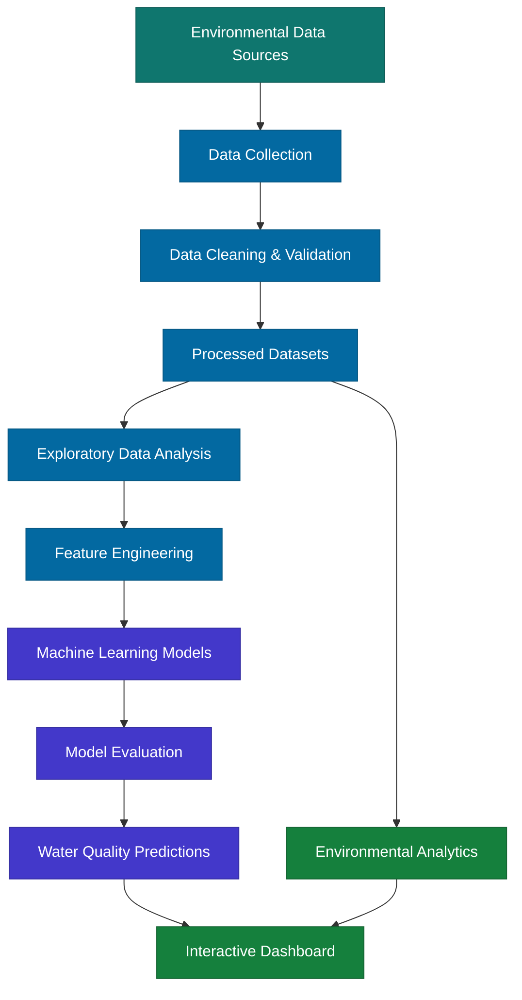

# AquaMind
AI-powered Water Quality Monitoring and Prediction System for Armenia.

 
<div align="center">

# AquaMind

### AI-Powered Water Quality Monitoring and Prediction System for Armenia

**Understanding Water. Protecting Tomorrow.**

<br>


<br>

<!-- Add your project banner image here later -->
<!-- Example:  -->

<br><br>

**ENVIRONMENTAL MONITORING · DATA ANALYTICS · ARTIFICIAL INTELLIGENCE · PREDICTION**

<br>

An AI-powered environmental research project designed to analyze water quality data, explore environmental trends, and develop predictive models for rivers and water resources across Armenia.

<br>

**Explore the Project** •
**System Architecture** •
**Development Roadmap** •
**Project Team**

</div>

---

## 🌍 Project Overview

**AquaMind** is an environmental artificial intelligence project focused on monitoring and analyzing water quality across Armenia, including the Hrazdan River and other important water resources.

The project aims to collect and organize environmental data, analyze historical water quality indicators, identify patterns, and explore how artificial intelligence can support the prediction of potential changes in water quality.

By combining environmental data analysis, machine learning, and interactive visualization, AquaMind seeks to make water quality information more accessible and understandable.

The project combines:

- Environmental data collection and research
- Data engineering and preprocessing
- Statistical analysis and visualization
- Machine learning and predictive modeling
- Interactive geographical visualization

> **Our Mission**
>
> Transform environmental data into meaningful insights using artificial intelligence to support better understanding and protection of Armenia's water resources.

---

## 🎯 Project Goals

<table>
<tr>
<td width="50%" valign="top">

### 🌊 Water Quality Monitoring

Organize and analyze available water quality observations to understand the condition of rivers and other water resources.

</td>
<td width="50%" valign="top">

### 📊 Environmental Data Analysis

Explore historical datasets, identify patterns, and examine relationships between important water quality indicators.

</td>
</tr>
<tr>
<td valign="top">

### 🧠 Predictive Modeling

Develop and evaluate machine learning models to predict potential changes in selected water quality indicators.

</td>
<td valign="top">

### 🗺️ Interactive Visualization

Create an accessible interface with charts, tables, and geographical maps for exploring environmental information.

</td>
</tr>
</table>

---

## ✨ Planned Key Features

| Feature | Description | Development Stage |
|:---|:---|:---|
| 🌊 Water Quality Analysis | Analyze historical water quality indicators | Planned |
| 🧪 Indicator Monitoring | Explore pH, BOD₅, ammonium, nitrates, dissolved oxygen, and temperature | Planned |
| 📈 Environmental Trend Analysis | Identify historical patterns and changes | Planned |
| 🧠 AI Prediction Models | Predict potential changes in selected water quality indicators | Planned |
| 🗺️ Interactive River Map | Display geographical information about selected Armenian rivers | Planned |
| ⚠️ Environmental Risk Analysis | Explore possible water quality risks based on available data | Planned |
| 📊 Data Visualization | Present observations and analysis through charts and tables | Planned |
| 🖥️ Interactive Dashboard | Provide a user-friendly interface for exploring results | Planned |

*Feature availability and scope will be updated as implementation progresses.*

---

## 🏗️ System Architecture

AquaMind is designed around a modular and reproducible environmental data science workflow.



### Architecture Principles

**Modularity** — Separate project components into manageable and independently testable modules.

**Reproducibility** — Document data processing steps and machine learning experiments.

**Scalability** — Allow the system to support additional rivers, datasets, and prediction targets.

**Scientific Transparency** — Clearly communicate data limitations, model assumptions, and evaluation results.

---

## 🛰️ Environmental Data Sources

AquaMind plans to investigate publicly available environmental data sources relevant to water quality and environmental conditions in Armenia.

| Data Category | Potential Source | Intended Application |
|:---|:---|:---|
| Water Quality | Armenian environmental open data | Historical water quality analysis |
| Environmental Monitoring | Armmonitoring | Environmental observations and monitoring data |
| Environmental Statistics | Armenian Ministry of Environment | Environmental context and research |
| Climate Data | Open-Meteo Historical Weather API | Historical weather analysis |
| Satellite Data | Microsoft Planetary Computer | Remote sensing exploration |

### Data References

- [Ecoportal Armenia](https://ecoportal.am/)
- [Armmonitoring](https://armmonitoring.am/)
- [Ministry of Environment of Armenia](https://env.am/)
- [Open Data Portal of Armenia](https://data.opendata.am/)
- [Open-Meteo Historical Weather API](https://open-meteo.com/en/docs/historical-weather-api)
- [Microsoft Planetary Computer](https://planetarycomputer.microsoft.com/)

### Data Quality Requirements

Before including datasets in the project, they should be evaluated for:

- Source reliability and availability
- Licensing and permitted usage
- Geographical coverage
- Historical data availability
- Missing values and measurement consistency
- Compatibility with selected prediction targets

*The listed sources are potential references. Their data availability and suitability will be verified during the research phase.*

---

## 🧠 Artificial Intelligence & Machine Learning

Machine learning is one of the central components of AquaMind.

The project aims to investigate historical environmental observations and develop models that can identify patterns and predict potential changes in selected water quality indicators.

### Planned Machine Learning Workflow

**Stage 1 — Data Exploration**

Understand the structure, quality, and characteristics of available environmental datasets.

**Stage 2 — Data Preprocessing**

Handle missing values, clean records, and prepare datasets for modeling.

**Stage 3 — Exploratory Data Analysis**

Investigate relationships between water quality indicators and environmental variables.

**Stage 4 — Model Development**

Experiment with suitable machine learning algorithms and establish baseline models.

**Stage 5 — Model Evaluation**

Evaluate model performance using appropriate metrics and validation methods.

**Stage 6 — Prediction & Visualization**

Present prediction results and analytical insights through visualizations and an interactive interface.

### Important Water Quality Indicators

| Indicator | Description |
|:---|:---|
| pH | Indicates the acidity or alkalinity of water |
| BOD₅ | Biochemical Oxygen Demand over five days |
| Ammonium | An important indicator in water quality assessment |
| Nitrates | A nitrogen compound relevant to water quality |
| Dissolved Oxygen | Amount of oxygen dissolved in water |
| Water Temperature | Temperature of the water |

### Planned Evaluation Metrics

| Metric | Purpose |
|:---|:---|
| MAE | Measures average absolute prediction error |
| RMSE | Penalizes larger prediction errors |
| R² | Measures the proportion of explained variance |
| Error Analysis | Helps identify model weaknesses |
| Validation | Evaluates model performance on unseen data |

**Scientific Note:** No predictive accuracy claims will be made before models are trained and evaluated using appropriate datasets.

---

## 🛠️ Technology Stack

The following technologies are proposed for AquaMind's development.

<div align="center">

### Core Development


### Data Science & Machine Learning


### Visualization & Interface


</div>

### Planned Technical Components

| Category | Technologies |
|:---|:---|
| Programming | Python |
| Data Processing | Pandas, NumPy |
| Scientific Computing | NumPy |
| Machine Learning | Scikit-learn |
| Data Visualization | Matplotlib, Plotly |
| Interactive Maps | Folium |
| Interactive Interface | Streamlit |
| Notebook Environment | Jupyter Notebook |
| Version Control | Git, GitHub |
| Project Management | Notion |

*The technology stack may evolve depending on dataset characteristics and development requirements.*

---

## 📁 Repository Structure

The following structure is planned for the AquaMind repository.

```text
AquaMind/
│
├── assets/
│   ├── aquamind-logo.png
│   └── aquamind-banner.png
│
├── dashboard/
│
├── data/
│   ├── raw/
│   └── processed/
│
├── docs/
│
├── notebooks/
│
├── src/
│
├── tests/
│
├── .gitignore
├── LICENSE
├── README.md
└── requirements.txt
```

### Directory Guide

| Directory | Purpose |
|:---|:---|
| `assets/` | Project logo, banner, and visual resources |
| `dashboard/` | Interactive dashboard application |
| `data/raw/` | Original environmental datasets |
| `data/processed/` | Cleaned and transformed datasets |
| `docs/` | Technical and scientific documentation |
| `notebooks/` | Research notebooks and experiments |
| `src/` | Core Python modules and ML components |
| `tests/` | Automated tests and validation |

**Repository Status:** The repository structure is currently under development. The directories above represent the planned organization and may be added progressively.

---

## 🗓️ Development Roadmap

**Project Period: November 28, 2026 – January 31, 2027**

| Phase | Timeline | Focus |
|:---|:---|:---|
| **00 — Preparation** | Nov 28–30, 2026 | Project organization and initial planning |
| **01 — Research & Planning** | Dec 1–10, 2026 | Research, data source identification, technical planning |
| **02 — Data Engineering** | Dec 11–25, 2026 | Data collection, preprocessing, exploratory analysis |
| **03 — Baseline ML Development** | Dec 26, 2026 – Jan 8, 2027 | Initial models and evaluation |
| **04 — AI & Dashboard Development** | Jan 9–22, 2027 | Model development, visualizations, interface |
| **05 — Testing & Delivery** | Jan 23–31, 2027 | Testing, documentation, presentation, final demonstration |

### Development Milestones

- [ ] Project research and idea validation
- [ ] Technical implementation plan
- [ ] Environmental dataset collection
- [ ] Data quality assessment
- [ ] Data preprocessing pipeline
- [ ] Exploratory data analysis
- [ ] Baseline machine learning model
- [ ] Model evaluation
- [ ] Water quality prediction experiments
- [ ] Interactive geographical map
- [ ] Dashboard development
- [ ] Testing and quality assurance
- [ ] Final documentation
- [ ] Project presentation and demonstration

*Milestones will be updated as deliverables are completed and verified.*

---

## 🚀 Getting Started

### Prerequisites

- Python 3.x
- Git
- pip

### 1. Clone the Repository

```bash
git clone https://github.com/bench-creator/AquaMind.git
cd AquaMind
```

### 2. Create a Virtual Environment

```bash
python -m venv .venv
```

### 3. Activate the Environment

**Windows PowerShell**

```powershell
.venv\Scripts\Activate.ps1
```

**Windows Command Prompt**

```cmd
.venv\Scripts\activate.bat
```

**macOS / Linux**

```bash
source .venv/bin/activate
```

### 4. Install Dependencies

Once the `requirements.txt` file is added:

```bash
python -m pip install --upgrade pip
python -m pip install -r requirements.txt
```

### 5. Run Tests

Once the test suite is implemented:

```bash
python -m pytest
```

### Dashboard

The interactive dashboard is planned for a future development stage. Launch instructions will be added when a working application is available.

---

## 👥 Project Team

<div align="center">

### Three People. One Mission.

*Combining project coordination, artificial intelligence, data engineering, and quality assurance.*

</div>

| Team Member | Position | Responsibility |
|:---|:---|:---|
| **Ruben** | Team Lead, Team Coordinator & Data Engineer | Project management, data collection, preprocessing, and dataset preparation |
| **Mane** | ML / AI Engineer & Interface Developer | Machine learning, model experiments, API design, and interactive interface |
| **Mayis** | Testing & Presentation Lead | Testing, quality assurance, documentation, and final presentation |

### Team Responsibilities

**Ruben — Project Coordination & Data Engineering**

- Define weekly goals and coordinate project activities.
- Maintain the task board and monitor progress.
- Identify and collect relevant environmental datasets.
- Prepare and clean data for machine learning.
- Organize training, validation, and testing datasets.
- Document data sources and dataset characteristics.

**Mane — Machine Learning & Interface Development**

- Develop and experiment with machine learning models.
- Select suitable approaches and evaluation metrics.
- Work with prepared datasets.
- Design model input/output interfaces.
- Develop interactive dashboards and visualizations.
- Present analytical and prediction results.

**Mayis — Testing & Presentation**

- Design test cases and evaluate system behavior.
- Check edge cases and possible limitations.
- Review model outputs and application functionality.
- Prepare user documentation and README updates.
- Create presentation materials and slides.
- Communicate project limitations and future development plans.

### Team Workflow

The team follows a collaborative development process based on task ownership, version control, and documented progress.

- **Notion** — project planning, responsibilities, and milestone tracking
- **GitHub** — source code management and version history
- **Task Tracking** — weekly goals and progress monitoring
- **Documentation** — research evidence and technical decisions

---

## 🤝 Contributing

AquaMind development follows a structured workflow.

1. Create a dedicated feature branch.
2. Implement the assigned functionality.
3. Add or update relevant tests.
4. Commit changes with descriptive messages.
5. Open a pull request.
6. Review and integrate approved changes.

### Branch Naming Examples

```text
feature/data-collection
feature/preprocessing
feature/baseline-ml
feature/water-quality-analysis
feature/interactive-map
feature/dashboard
docs/research
test/data-validation
```

### Commit Message Examples

```text
Add environmental data collection module
Implement water quality preprocessing
Create baseline machine learning model
Add interactive river map
Update project documentation
```

---

## 🔬 Scientific Integrity & Responsible AI

AquaMind is designed around responsible scientific and environmental research practices.

**Transparency:** Document data sources, processing steps, and analytical methods.

**Reproducibility:** Maintain clear experiment configurations and evaluation procedures.

**Reliability:** Validate data quality and model outputs before presenting results.

**Uncertainty:** Communicate prediction limitations and uncertainty.

**Environmental Responsibility:** Avoid unsupported conclusions about environmental conditions.

> AI predictions are research outputs and should not be interpreted as official environmental measurements or definitive ecological assessments.

---

## 📚 Documentation

Project documentation will be organized within the `docs/` directory.

Planned documentation includes:

- Project concept and problem definition
- Research questions and objectives
- Environmental data source inventory
- Dataset descriptions and data quality reports
- System architecture
- Data preprocessing methods
- Machine learning experiments
- Model evaluation results
- Testing and quality assurance
- Final presentation materials

---

## 🔮 Future Development

Potential future improvements include:

- Expanding environmental data coverage across Armenia.
- Integrating additional water quality datasets.
- Improving prediction models with new observations.
- Developing more advanced geographical visualizations.
- Exploring automated data acquisition.
- Investigating possible integration with environmental sensors.

*Sensor integration and automated monitoring are future possibilities, not currently implemented features.*

---

## 📄 License

This project is intended to be released under the **MIT License**.

See the `LICENSE` file for more information once it is added to the repository.

---

<div align="center">

<!-- Add the AquaMind logo here after creating assets/aquamind-logo.png -->


### AquaMind

**Understanding Water. Protecting Tomorrow.**

*AI-Powered Environmental Intelligence for Armenia.*

**Armenia · Environmental Research · Artificial Intelligence**

<br>


</div>
